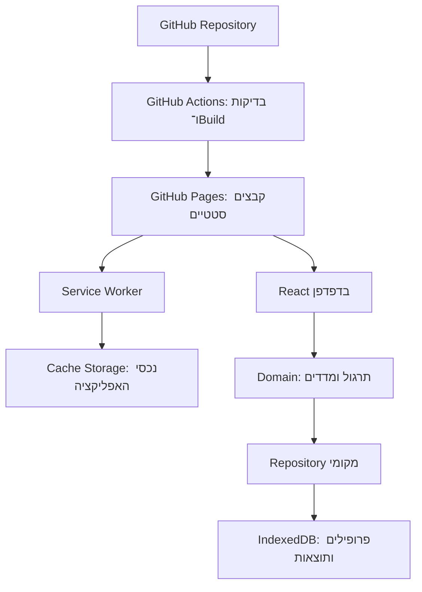

# ARCHITECTURE — כפל בכיף

מבוסס על PRD של „כפל בכיף”. תאריך בדיקת המקורות: 19.10.2026.

## 1. Technology Stack שנבחר

המערכת תהיה Client-side SPA סטטית, עם שלושה מסכים, אחסון מקומי ויכולת Offline. אין צורך בשרת אפליקטיבי, בחשבונות מקוונים או במסד נתונים בענן.

| רכיב | בחירה | תפקיד |
| --- | --- | --- |
| Frontend | React + TypeScript במצב strict | מסכים, טפסים, משוב ומצבי התרגול |
| Build | Vite ותוסף React הרשמי | שרת פיתוח, אריזת Production ומשאבים עם Content Hash |
| Styling | CSS Modules ו־CSS רגיל | עיצוב Responsive, RTL ובידוד סגנונות |
| State | React Hooks, useReducer ו־Context מצומצם | מצב תרגיל, פרופיל פעיל ומצב שמירה |
| ניווט | Hash navigation באמצעות Browser API | שלושה מסכים ללא צורך בשרת שמבצע URL Rewrites |
| נתונים מקומיים | IndexedDB באמצעות Dexie.js | פרופילים ותוצאות, אינדקסים, Transactions ו־Schema Versions |
| PWA | vite-plugin-pwa עם Workbox generateSW | Manifest, יצירת Service Worker ו־Precache |
| גרף | SVG מקומי בתוך React | גרף יומי פשוט ללא ספריית Charts נוספת |
| תמונות ואווטארים | נכסים סטטיים באריזת האתר | זמינות מקומית ו־Offline |
| Runtime לפיתוח ול־CI | Node.js 24 LTS ו־npm | התקנה ו־Build בלבד; אינם רצים בשרת Production |
| בדיקות | Vitest ו־Playwright | לוגיקה, שמירה, זרימות דפדפן ו־Offline |
| Source Control | Git ב־GitHub | ניהול גרסאות, Pull Requests ו־Lockfile |
| Hosting ו־CI/CD | GitHub Pages + GitHub Actions | Build ופרסום אוטומטי של האתר הסטטי |

Backend, Authentication Service, Cloud Database, Object Storage, שירות AI ו־External APIs אינם נדרשים. יצירת התרגילים והרמזים היא חישוב מקומי דטרמיניסטי; אין הצדקה לשירות AI בזמן שימוש.

### נימוקי הבחירה ותאימות

- **React ו־TypeScript:** הועדפו על Vue ועל Vanilla TypeScript בגלל מודל Components ברור וניהול עקבי של מצבי תרגול, שמירה ומשוב. Vue מתאים גם הוא; Vanilla מצמצם תלויות אך מחייב יותר תיאום ידני של הממשק. הבחירה ב־React היא שיקול תחזוקתי ופיתוח באמצעות AI, ולא טענה למדידת איכות של מודלים. התיעוד הרשמי מציג במפורש תבנית React–TypeScript עם Vite. אין דרישת SSR, ולכן Framework של Full Stack אינו נחוץ. [1][2]
- **Vite:** הועדף על Parcel ועל Rsbuild בזכות תבנית React–TypeScript, חיבור מתועד ל־GitHub Pages ואינטגרציית PWA. שלושתם כלי Build רלוונטיים; כאן מסלול הפריסה וה־PWA הוא הגורם המכריע. [1][3]
- **IndexedDB ו־Dexie:** נבחנו localStorage, IndexedDB עם idb ו־Dexie. localStorage סינכרוני ואינו מתאים באותה מידה לעדכונים אטומיים של רשומות רבות. idb הוא Wrapper קטן ומועיל; Dexie נבחר בזכות שאילתות, Transactions ו־Version Upgrades קריאים שמפחיתים קוד תשתית. אין שימוש ב־Dexie Cloud. [4][5][6]
- **PWA:** נבחנו Service Worker ידני, Workbox ישיר ו־vite-plugin-pwa. נבחר התוסף המשלב Workbox ב־Build, במקום תחזוקה ידנית של רשימת הקבצים ב־Cache. השימוש הוא ב־generateSW; אין צורך ב־Service Worker מותאם באמצעות injectManifest. [7][8]
- **SVG ו־CSS:** לגרף יחיד עם סדרה יומית אחת ולשלושה מסכים, SVG ו־CSS Modules מספיקים. Chart.js ו־Recharts מוסיפים יכולות שאינן נחוצות בגרסה זו; אין צורך ב־UI Framework. [9]
- **GitHub Pages:** נבחן לצד Vercel ו־Cloudflare Pages, ששניהם תומכים בחיבור Git. Pages עונה על הדרישות והעדפת הפריסה, ללא שירות נוסף. [3][10][11]
- **בדיקות:** Vitest הועדף על Jest בשל השילוב עם Vite ו־TypeScript. Playwright נבחר לבדיקות בדפדפנים וב־Offline; אלה כלים משלימים, לא שתי מערכות לבדיקת אותו דבר. [12][13]

תאימות המכלול: React ו־TypeScript נארזים לקבצים סטטיים באמצעות Vite; Dexie פועל בדפדפן; תוסף PWA יוצר Service Worker ו־Manifest בזמן Build; Pages מגיש את התוצרים ב־HTTPS. Node.js משמש בפיתוח וב־CI בלבד. Node.js 24 הוא קו LTS שנבחר, מעל דרישת המינימום המתועדת של Vite. [1][3][14]

**מדיניות גרסאות:** אין שימוש ב־Beta או Canary. בעת יצירת הפרויקט יינעלו גרסאות Stable מדויקות ב־package-lock.json; React ו־react-dom יהיו באותה גרסה. יש להתאים את Vite לטווח peerDependencies של גרסת vite-plugin-pwa שנבחרה ולא לשדרג Major אוטומטית. אותו Node.js 24 patch ישמש בפיתוח וב־CI. התכנון אינו מציג בדיקת Build שבוצעה: שילוב הגרסאות המדויק יאומת ב־CI לפני פרסום. [15]

### עלויות ומגבלות

- **הנחת תכנון לעלות אפס:** Repository ציבורי ב־GitHub Free ושימוש בכתובת github.io, ללא רכישת Domain. אין עלויות Database, AI או API. אם נדרשת סודיות של קוד המקור, Pages עבור Repository פרטי תלוי בתוכנית GitHub מתאימה; אין לשנות נראות Repository קיים אוטומטית. [16]
- מגבלות Pages שנבדקו: אתר מפורסם עד 1 GB, תעבורה עם Soft Limit של 100 GB לחודש ו־Deployment Timeout של 10 דקות. מגבלת 10 Builds בשעה אינה חלה על Custom GitHub Actions Workflow. אלו מגבלות שירות ולא יעד לגודל האפליקציה. [16]
- Standard GitHub-hosted Runners חינמיים עבור Repositories ציבוריים; Larger Runners מחויבים בנפרד. יש להימנע מצבירת Artifacts מיותרת. [17]
- הנתונים נשמרים רק בדפדפן. מחיקת נתוני האתר, גלישה פרטית או מדיניות Eviction עלולות להסירם. אין גיבוי, ואין הבטחה לשיתוף נתונים בין דפדפן ל־PWA מותקן בכל מערכת. שינוי Origin מחייב התייחסות לאובדן גישה לנתונים הקיימים. [18]
- ההתקנה משתנה בין דפדפנים ומערכות; ב־iOS אין להסתמך על beforeinstallprompt. התקנה ויכולת Offline הן שתי יכולות נפרדות. [19]
- Pages אינו מיועד להפעלת עסק מקוון או Commercial SaaS. המוצר המתואר הוא כלי לימודי ללא עסקאות; שינוי עסקי כזה יחייב בחינה מחדש של ה־Hosting. [16]

## 2. מבנה המערכת והאחריות

### טופולוגיה

ה־Service Worker מטפל בנכסי האפליקציה; IndexedDB מטפל בנתוני הילדים. אין להעביר תוצאות ל־GitHub או ל־Cache Storage, ואין Service Worker שמחשב ציונים.

### Modules ושכבות לוגיות

| Module | אחריות וקשרים |
| --- | --- |
| App Shell | ניווט, שפה, פרופיל פעיל וחיווי שגיאות תשתית |
| Home / Profiles | כינוי, בחירת אווטאר, יצירת פרופיל ובחירתו דרך Repository |
| Learning | בחירת סוג תרגול, שדה תשובה, משוב, רמז ופעולת המשך |
| Progress | שאילתת רשומות הפרופיל, Aggregation יומי ו־SVG |
| About | הסבר וטבלת לוח הכפל הנוצרת בקוד |
| Practice Domain | הגרלת גורמים, Validation, בדיקת מכפלה ורמז חיבור חוזר |
| Results Domain | הגדרת ניסיון, First-attempt Accuracy ושיוך יום |
| Persistence | Dexie, Transactions, הפרדת פרופילים ו־Migrations |
| PWA Infrastructure | Manifest, Precache, Offline readiness ומחזור חיי עדכון |

הלוגיקה המתמטית והמדדים יהיו פונקציות TypeScript עצמאיות ללא תלות ב־React, ב־DOM או ברשת. Components אינם פונים ל־Dexie ישירות אלא דרך שכבת Persistence. אין Redux, מערכת Events כללית או Server-state Library.

## 3. Frontend, ניווט ו־State

- שלושה Routes בלבד: `#/home`, `#/learn`, `#/about`. ניווט יתבסס על location.hash ו־hashchange; כפתור Back של הדפדפן יתמוך במעברים.
- כניסה למסך לימוד ללא פרופיל פעיל תחזיר לבית. Route לא מוכר יפנה לבית. כינוי ונתוני תרגול לא יופיעו ב־URL.
- שימוש ב־Hash משאיר בקשות מסמך בנתיב האתר הראשי, ולכן Refresh אינו דורש Fallback של השרת.
- Context קטן מכיל profileId פעיל ושירותי האפליקציה; מצב התרגיל מוחזק ב־useReducer. אין כתיבה לנתונים מתוך Render או Effect שנועד ליצירת תוצאה עסקית.
- מצבי תרגיל: `awaitingAnswer`, `saving`, `incorrect`, `correct`. מצב שמירה הוא מצב UI פנימי, לא מסך נוסף.
- טעות חוזרת לא משנה תרגיל. הצלחה חושפת „לתרגיל הבא” בלבד כפעולת התקדמות; הכפתור אינו פעיל במופע החדש עד שהתרגיל נפתר.
- ב־saving ננעלים בדיקה, שינוי מצב ומעבר פרופיל עד סיום הפעולה. ניווט מאוחר או תשובה אסינכרונית לא יוכלו לשייך תוצאה לפרופיל אחר: כל Command מכיל profileId ו־exerciseId שנלכדו בתחילתו.
- לאחר רענון אפשר ליצור תרגיל חדש, בהתאם ל־PRD. רשומות שנבדקו נשארות; תרגיל שלא נבדק אינו נכלל במדדים.

### RTL, קלט וגרף

`html lang="he" dir="rtl"`; CSS Logical Properties במקום תלות בכיווני ימין ושמאל. ביטוי מתמטי יבודד ב־`dir="ltr"` עם Unicode Bidi Isolation. שדה תשובה טקסטואלי עם inputmode="numeric"; Validation מפורש לשלמים 1–100 ימנע קבלה חלקית של מחרוזות כגון „12abc”.

משוב יוצג גם בטקסט וב־aria-live, עם Labels ו־Focus ברור. הגרף יהיה SVG Responsive עם ציר זמן כרונולוגי משמאל לימין, תוויות בעברית וציר אחוזים קבוע 0–100. הגרף מציג לכל היותר את 7 ימי התרגול האחרונים (ימים עם checkedCount > 0); ימים ישנים יותר נשארים שמורים ואינם נמחקים. ימי התרגול מוצגים במרווחים שווים זה מזה, ללא תלות במספר הימים שעברו ביניהם, כדי שהגרף יישאר מסודר וקריא לילדים; התאריך שמתחת לכל נקודה מציין מתי תורגל. אין להוסיף נקודת 0 ליום שלא תורגל. נתון יחיד יוצג כנקודה, ללא טענת מגמה. הסיכום המספרי נשאר HTML נגיש, ללא תלות בהבנת הגרף.

## 4. Data Model ואחסון

Database מקומי: `kefel-bekef-db`. שמו קבוע בין גרסאות; אין ליצור Database חדש בכל Deployment.

### ישויות נשמרות

| ישות | שדות עיקריים | מפתח ואינדקסים |
| --- | --- | --- |
| Profile | id, nickname, avatarId, createdAt | Primary Key: id |
| ExerciseResult | id, profileId, factorA, factorB, mode, selectedFactor?, firstCheckedAt, firstCheckLocalDate, firstAttemptCorrect, attemptCount, solved, solvedAt?, lastSubmittedAnswer, lastSubmissionKey, revision | Primary Key: id; אינדקס profileId ואינדקס מורכב [profileId+firstCheckLocalDate] |

- מזהים נוצרים מקומית באמצעות crypto.randomUUID. כמה פרופילים יכולים לשאת אותו כינוי; הזהות היא id, ללא הנחת ייחודיות שלא נדרשה.
- avatarId מפנה למבחר נכסים מקומיים; אין שמירת תמונות ילדים.
- הקשר הוא Profile אחד לרשומות ExerciseResult רבות. Persistence יוודא שהפרופיל קיים לפני כתיבה; IndexedDB אינו מספק Foreign Keys אוטומטיים.
- מזהה תרגיל נוצר בהצגתו אך הרשומה נוצרת רק בבדיקה תקינה ראשונה. אותם גורמים בהגרלה חדשה יקבלו id חדש.
- mode הוא random או selectedFactor. התוצאה הנכונה מחושבת מהגורמים ואינה חייבת להישמר.
- firstCheckedAt ו־solvedAt הם Timestamps; firstCheckLocalDate הוא מפתח YYYY-MM-DD הנבנה מרכיבי תאריך מקומיים, ללא חיתוך של ISO UTC.
- firstAttemptCorrect ו־firstCheckLocalDate נעולים לאחר יצירה, גם לאחר חצות או שינוי אזור הזמן. אין השוואה מחדש לתאריך הנוכחי כדי לשכתב היסטוריה.
- אין ישות DailyStats נשמרת: היא נגזרת מהתוצאות כדי למנוע אי־התאמה בין שני מקורות אמת.
- אין לוג מלא של כל תשובה. נשמרים רק הנתונים הדרושים למדד, למספר הניסיונות ולמניעת כפילויות.
- Exercise State, שדה ההקלדה והפרופיל הפעיל נשמרים בזיכרון. אין חובה לזכור בחירת פרופיל לאחר סגירה.

### חישוב התקדמות

לכל profileId מקבצים רשומות לפי firstCheckLocalDate:

- checkedCount = מספר הרשומות.
- firstCorrectCount = מספר הרשומות עם firstAttemptCorrect=true.
- accuracy = 100 × firstCorrectCount / checkedCount.
- המכנה אפס: אין נתון אחוזי ואין נקודת גרף.
- עיגול הוא לצורכי תצוגה בלבד; החישוב נשאר מדויק.
- התיקון של תרגיל שנענה תחילה בטעות מעדכן solved ו־attemptCount אך אינו משנה את אחוז ההצלחה בניסיון הראשון.

הנתונים משני מצבי התרגול נכללים באותו מדד לפי ה־PRD; אין ניקוד משוקלל או מדד שליטה לכל כפולה.

## 5. ממשקים ו־Data Flow

אין REST API, GraphQL או External API. הממשקים הם Commands ו־Queries פנימיים מסוגי TypeScript: יצירת פרופיל, רשימת פרופילים, בדיקת תשובה, טעינת תוצאות וחישוב סדרה יומית. התוצאה מכל כתיבה מבדילה בין הצלחת שמירה, פעולה כפולה וכשל שמירה.

### בדיקת תשובה

1. Validate לקלט; קלט לא תקין מציג את הודעת ה־PRD ואינו פותח כתיבה.
2. לכידת snapshot של מזהה הפרופיל והתרגיל, התשובה ו־submissionKey ייחודי. נעילה מיידית גם באמצעות Guard סינכרוני, לפני Render הבא.
3. פונקציית Domain מחשבת נכונות ורמז.
4. Transaction של Dexie קורא את הפרופיל והרשומה הקיימת. אם solved=true או submissionKey כבר עובד, אין עדכון נוסף.
5. בבדיקה הראשונה נוצרת רשומה עם attemptCount=1 ונתוני הניסיון הראשון. לאחר מכן מעדכנים מונה ומצב פתרון בלבד.
6. בדיקה חוזרת של אותו ערך מספרי כמו lastSubmittedAnswer, ללא בדיקה ביניים של ערך אחר, לא נספרת שוב. כתיבה מותנית ב־revision הצפוי; במקרה התנגשות טוענים מחדש את התוצאה ולא מגדילים מונה בעיוורון.
7. Commit מוצלח מעדכן את ה־UI ואת ההתקדמות. אין להמתין לסגירה, ל־unload או לחזרת האינטרנט לשמירת התוצאות.
8. בכשל שמירה מוצג בנפרד „התוצאות לא נשמרו במכשיר”. אפשר להמשיך לתרגל בזיכרון, אך ההתקדמות השמורה לא תוצג כאילו עודכנה. ניסיון חוזר של אותה כתיבה משתמש באותו submissionKey.

Transaction יהיה קצר וללא Fetch או המתנה ל־UI בתוכו. מנגנון זה, נוסף על נעילת הכפתורים, מונע כפילות ואובדן עדכונים. זהו מנגנון מקומי בלבד, לא תור סנכרון לענן.

### החלפת פרופיל

יש לסיים כתיבה פעילה, לזרוק מצב תרגיל זמני, לבחור profileId חדש ולטעון רק את נתוניו. אין שימוש בכינוי כמפתח ואין מיזוג תוצאות בין פרופילים.

## 6. PWA, Offline ועדכונים

### נכסים ו־Manifest

- Manifest: שם „כפל בכיף”, lang=he, dir=rtl, display=standalone, start_url ו־scope תחת Base Path של האתר ו־id יציב. אייקוני PNG ב־192 ו־512, כולל Maskable מתאים, ו־Apple Touch Icon.
- `base` של Vite הוא `/<repository-name>/` באתר Project Pages; ב־Domain בשורש הוא `/`. משתמשים ב־BASE_URL לנכסים ולרישום Service Worker. אין נתיבים מוחלטים שגויים לשורש github.io.
- ה־Service Worker מוגש תחת אותו Base Path וה־Scope שלו אינו מורחב לכל החשבון.
- מקור האיורים הוא תיקיית `assets` בשורש הפרויקט (רשימת הקבצים ב־DESIGN.md). בזמן הבנייה הם מועתקים לתיקיית הנכסים הסטטיים של Vite, מכווצים לפי הצורך, ומ־`app-icon.png` נוצרים אייקוני 192, 512, Maskable ו־Apple Touch Icon.
- Precache מפורש ל־HTML, JS, CSS, איור הבית, רקע הכותרת, כל האווטארים, האייקונים והגופנים המקומיים. לוח הכפל במסך האודות הוא טבלת HTML ואינו קובץ תמונה. ברירת המחדל אינה כוללת כל סוג תמונה, לכן יוגדרו globPatterns מתאימים.
- ללא Fonts, תמונות או Scripts מ־CDN בזמן שימוש. שלושת המסכים נארזים מראש; אין Lazy Loading המשאיר מסך לא זמין ב־Offline.

### מוכנות וגבולות Offline

לא מציגים מוכנות לפני שה־Service Worker הותקן, משאבי ה־Precache הושלמו והעמוד נשלט כנדרש. כשל בהכנה משאיר אפשרות לנסות שוב עם אינטרנט. לאחר מכן האתר והנתונים פועלים ללא רשת.

**מגבלת פלטפורמה:** כניסה ראשונה אי פעם למכשיר ללא אינטרנט אינה יכולה לטעון אפילו הודעה מתוך האתר, מפני שהקוד טרם הורד. במקרה זה מוצגת הודעת הדפדפן. כאשר App Shell כבר נטען אך ההכנה אינה מלאה, האפליקציה יכולה להציג „נדרש חיבור לאינטרנט להשלמת הטעינה הראשונית”. זהו גבול טכני למקרה הקצה ב־PRD, לא ביטול התמיכה ב־Offline.

### מחזור חיי עדכון

- registerType יהיה prompt; אין autoUpdate המבצע Reload במהלך תרגיל.
- גרסה חדשה מתקינה Cache חדש ונשארת waiting. אין הפעלת skipWaiting בכוח מתוך תרגול פעיל.
- אין צורך במסך עדכון או בכפתור מוצר נוסף: הגרסה הממתינה תופעל במחזור החיים הרגיל לאחר סגירת כל החלונות הנשלטים על ידי הגרסה הישנה ופתיחה מחדש.
- עד אז משאבי הגרסה הפעילה נשארים זמינים. ניקוי Cache ישן יוגבל ל־Caches של האפליקציה; הוא אינו מוחק IndexedDB.
- תוצאות נשמרות אחרי כל בדיקה, ולכן אינן תלויות במועד העדכון.

## 7. Schema Migrations והתאוששות

Dexie מנהל Schema Versions עוקבים ו־upgrade מקומי בזמן פתיחת הנתונים. כל שינוי נבדק על נתוני דוגמה מגרסה קודמת לפני Build לפרסום. ה־Migration רץ אוטומטית במכשיר עם הפעלת הקוד החדש, בתוך מנגנון השדרוג של IndexedDB; אין מסד Production מרכזי ואין שינוי שרץ בשרת.

יש להעדיף שינויים Additive ולשמור את נתוני הניסיון הראשון. אין מחיקה ויצירה מחדש כפתרון לשגיאה. לשינוי חסום על ידי Tab ישן יש לסגור חיבור ישן בעת versionchange ולהציג הנחיה לסגירת חלונות ישנים. בכשל שדרוג משאירים את הנתונים ומציגים שגיאת שמירה.

Rollback של קוד מחייב תאימות ל־Schema שכבר שודרג. אין לבצע Downgrade של IndexedDB; כאשר אינו אפשרי, מפרסמים תיקון קדימה. אין מחיקת תוצאות אוטומטית או מדיניות Retention שלא הוגדרה ב־PRD.

## 8. אבטחה ופרטיות

- אין Authentication או Authorization עסקי. profileId הוא הפרדה לוגית בלבד, וכל משתמש באותו דפדפן יכול לבחור פרופיל אחר.
- HTTPS ב־Pages; ללא סודות, מפתחות API או נתונים אישיים ב־Repository או ב־Build.
- הצגת כינויים באמצעות React Text Rendering, ללא dangerouslySetInnerHTML. תמונות ואווטארים נטענים רק מרשימת נכסים פנימית.
- תוצאות אינן נשלחות לרשת. אין Analytics, פרסום, Tracking או שירות Error Reporting חיצוני.
- GitHub מתעד כתובות IP לצורכי אבטחת Hosting; לכן „הנתונים נשארים במכשיר” מתייחס לנתוני הפרופיל והתרגול, ולא להיעדר לוגי תשתית. [20]
- IndexedDB אינו מוצפן בהצפנה ייעודית של המוצר. Same-origin Isolation אינו הגנה מפני מי שיש לו גישה למכשיר.
- באתרי Project Pages תחת אותו owner.github.io האחסון מופרד לפי Origin ולא לפי נתיב. שם Database ו־Cache ייחודיים מונעים התנגשות מקרית אך אינם גבול אבטחה. יש לארח תחת Origin זה רק קוד מהימן.
- אין צורך בהרשאות מצלמה, מיקום או Notifications. הרשאות פרסום הקוד נפרדות מפרופילי הילדים.
- טיפול ב־QuotaExceededError ובכשלי פתיחת Database אינו מוחק תוצאות. אין הבטחת גיבוי או זיהוי ודאי של מחיקה שכבר התרחשה.

## 9. GitHub, Hosting ו־Deployment

קוד המקור, הנכסים, Manifest Configuration, בדיקות, Workflow ו־package-lock.json ינוהלו באותו Git Repository ב־GitHub. אין צורך לפתוח Repository או לפרסם אתר במסגרת יצירת מסמך זה.

### Development ו־Production

Development רץ ב־localhost באמצעות Vite, ללא Docker או שירותי ענן. Production הוא כתובת HTTPS קבועה של Pages. לכל Origin אחסון מקומי נפרד; אין להעתיק נתוני ילדים לנתוני בדיקה. אין Supabase, פרטי חיבור ל־Database או צורך בשני פרויקטי ענן.

תצורה נחוצה: Base Path, שם ואייקונים, צבעי Manifest ו־Build Identifier המבוסס על Commit. אלה אינם סודות. אין הכרח בקובץ env; כל ערך VITE_* נחשב ציבורי.

### CI/CD אוטומטי

- ב־Pull Request: התקנת Node.js הנעול, npm ci, בדיקת TypeScript, בדיקות יחידה, Build ובדיקות הדפדפן הרלוונטיות. אין Deployment ל־Production מ־Pull Request.
- בכל Push ל־main: אותן בדיקות, יצירת dist והעלאה כ־Pages Artifact, ולאחר הצלחה פרסום ב־GitHub Actions.
- Pages מוגדר עם Source מסוג GitHub Actions. משתמשים ב־Actions הרשמיים configure-pages, upload-pages-artifact ו־deploy-pages, ובגרסאות נתמכות ומקובעות.
- Job הפריסה מקבל contents:read, pages:write ו־id-token:write לפי הצורך; אין Personal Access Token בקוד. רק main יפרסם, ו־Concurrency ימנע פריסות מתחרות.
- Build או בדיקות שנכשלו אינם מחליפים את האתר הפעיל. שחזור גרסת קוד יתבצע באמצעות Commit ופריסה חוזרת, בכפוף לתאימות ה־Schema.
- Development Server אינו מדמה Service Worker מלא. בדיקות PWA רצות על תוצר Production באמצעות שרת Preview/HTTP מקומי ב־localhost, ובדיקת Smoke נוספת בכתובת Pages האמיתית.

Pages מגיש קבצים בלבד. מספר משתמשים גדול אינו מגדיל עלות עיבוד תרגילים בשרת; הוא מגדיל בעיקר תעבורת נכסים ראשונית, הכפופה למגבלות השירות.

## 10. אימות הארכיטקטורה

הבדיקות הן תנאי לאמינות המימוש ואינן פיצ'רים נוספים:

| תחום | מה יש לאמת |
| --- | --- |
| Domain | גבולות 1–10, תשובות 1–100, רמז מתאים (כולל רמז שאינו חושף תוצאה כשאחד הגורמים הוא 1) ואי־מעבר אוטומטי |
| First Attempt | טעות ואז הצלחה אינן משנות את המדד הראשון; תרגיל שננטש נשאר במכנה |
| כפילויות | לחיצות מהירות, אותו קלט, Retry של אותה כתיבה ושתי פעולות מתחרות |
| פרופילים | הפרדה מלאה וכתיבה שהושלמה בעת החלפה אינה זולגת לפרופיל החדש |
| תאריכים | חצות, שינוי אזור זמן, תאריך מקומי ולא UTC ומכנה אפס |
| Persistence | רענון, סגירה, כשל שמירה, Quota ו־Migration מגרסה קודמת |
| Offline | הכנה מלאה, ניתוק רשת, Reload וכל שלושת המסכים כולל נכסים |
| עדכון | גרסה חדשה במהלך תרגול אינה מבצעת Reload; הפעלתה בהמשך משמרת תוצאות |
| Deployment | Base Path, Hash Routes, Scope וטעינה תחת נתיב Project Pages |
| UX | RTL, סדר מתמטי, מקלדת מספרית, Labels, Focus וטקסט משוב |

יעד בדיקות טכני: Chrome ב־Android ו־Safari ב־iOS במכשירים אמיתיים עבור התקנה ו־Offline; בדיקות אוטומטיות ב־Chromium וב־WebKit, ו־Smoke בדפדפן Desktop. זו בחירת אימות טכנית, לא התחייבות לתמיכה בכל גרסה היסטורית. Playwright אינו מחליף בדיקת התקנה במכשיר אמיתי.

## 11. מקורות

מקורות רשמיים שנבדקו בתאריך המצוין בראש המסמך. ההכרעה בין חלופות היא מסקנת תכנון עבור מוצר זה, ולא דירוג אוניברסלי. תעריפים ומגבלות עשויים להשתנות.

1. [React — Build an app from Scratch](https://react.dev/learn/build-a-react-app-from-scratch)
2. [Vue — Introduction](https://vuejs.org/guide/introduction.html)
3. [Vite — Deploying a Static Site](https://vite.dev/guide/static-deploy.html)
4. [MDN — Web Storage API](https://developer.mozilla.org/en-US/docs/Web/API/Web_Storage_API)
5. [idb — תיעוד הפרויקט](https://github.com/jakearchibald/idb)
6. [Dexie — Transactions](https://dexie.org/docs/Dexie/Dexie.transaction%28%29), [Schema Upgrades](https://dexie.org/docs/Version/Version.upgrade%28%29)
7. [Vite PWA — Guide](https://vite-pwa-org.netlify.app/guide/), [Precache](https://vite-pwa-org.netlify.app/guide/service-worker-precache), [Update lifecycle](https://vite-pwa-org.netlify.app/guide/prompt-for-update)
8. [Workbox — workbox-build](https://developer.chrome.com/docs/workbox/modules/workbox-build)
9. [MDN — SVG](https://developer.mozilla.org/en-US/docs/Web/SVG), [Chart.js](https://www.chartjs.org/docs/latest/)
10. [Vercel — Git Integration](https://vercel.com/docs/git)
11. [Cloudflare Pages — Git Integration](https://developers.cloudflare.com/pages/configuration/git-integration/)
12. [Vitest — Guide](https://vitest.dev/guide/), [Jest — Getting Started](https://jestjs.io/docs/getting-started)
13. [Playwright — Service Workers](https://playwright.dev/docs/service-workers)
14. [Node.js — Releases](https://nodejs.org/en/about/previous-releases), [Vite — Getting Started](https://vite.dev/guide/)
15. [vite-plugin-pwa — Package ו־Peer Dependencies](https://github.com/vite-pwa/vite-plugin-pwa/blob/main/package.json)
16. [GitHub Pages — Limits and Availability](https://docs.github.com/en/pages/getting-started-with-github-pages/github-pages-limits)
17. [GitHub Actions — Billing](https://docs.github.com/en/billing/concepts/product-billing/github-actions)
18. [MDN — Storage Quotas and Eviction](https://developer.mozilla.org/en-US/docs/Web/API/Storage_API/Storage_quotas_and_eviction_criteria)
19. [MDN — Making PWAs Installable](https://developer.mozilla.org/en-US/docs/Web/Progressive_web_apps/Guides/Making_PWAs_installable)
20. [GitHub Pages — Hosting and Data Collection](https://docs.github.com/en/pages/getting-started-with-github-pages/what-is-github-pages)

## החלטות מרכזיות (ADRs)

### ADR-1: לוח הכפל במסך האודות כטבלת HTML
**הקשר:** ה־PRD דרש במקור תמונה של לוח הכפל. תמונה עלולה להיות מטושטשת במסכים שונים, ומספר שגוי בה קשה לזיהוי ולתיקון.
**החלטה:** הלוח נבנה כטבלת HTML הנוצרת בקוד מהמכפלות 1–10, בעיצוב שב־DESIGN.md. ה־PRD וה־DESIGN עודכנו בהתאם באישור המשתמשת.
**השלכות:** הטבלה חדה בכל גודל מסך, נגישה לקוראי מסך ונכונה בהגדרה; אין קובץ תמונה ל־Precache. העיצוב (כותרות Cyan ו־Sunshine, מסגרת Navy) ממומש ב־CSS.

### ADR-2: מקור האיורים בתיקיית `assets`
**הקשר:** האיורים (Hero, רקע כותרת, שלושה אווטארים ואייקון) הוכנו מחוץ לקוד, בסגנון ה־Mockups.
**החלטה:** הקבצים המקוריים נשמרים בתיקייה `assets` בשורש הפרויקט. בזמן הבנייה הם מועתקים לנכסים הסטטיים של האפליקציה, מכווצים לפי הצורך, ומהאייקון נוצרים כל הגדלים הנדרשים ל־PWA.
**השלכות:** החלפת איור נעשית על ידי החלפת הקובץ ב־`assets` ועדכון הנכס הסטטי. הטקסטים אינם חלק מהתמונות ונכתבים בקוד.

### ADR-3: גופנים מקומיים דרך חבילות Fontsource
**הקשר:** ה־DESIGN דורש Fredoka ו־Heebo, וה־ARCHITECTURE אוסר טעינת גופנים מ־CDN או מ־Google Fonts בזמן שימוש (נדרש גם ל־Offline).
**החלטה:** הגופנים מותקנים כחבילות npm ‏`@fontsource/fredoka` (משקלים 600, 700) ו־`@fontsource/heebo` (400, 700), ו־Vite אורז את קובצי הגופן יחד עם האתר. שתי החבילות כוללות תת־קבוצה עברית.
**השלכות:** אין בקשות רשת חיצוניות לגופנים; קובצי הגופן ייכללו ב־Precache ב־M5. הגרסאות נעולות ב־package-lock.json.

### ADR-4: גרסאות הכלים שנבחרו ב־M1
**הקשר:** מדיניות הגרסאות מחייבת גרסאות Stable מדויקות ו־Vite בטווח ה־peerDependencies של vite-plugin-pwa.
**החלטה:** React 19.3.1, Vite 8.3.4 (vite-plugin-pwa 2.0.0 תומך ב־`^8.0.0`), TypeScript 7.0.2, Vitest 5.0.5, Playwright 1.64.1, Node.js 24.22.0 (קובץ `.nvmrc`). הגרסאות מדויקות ב־package.json, ללא `^`. בדיקות הדפדפן רצות על Production Build דרך `vite preview`, ב־Chromium (Pixel 7) וב־WebKit (iPhone 13).
**השלכות:** שדרוג Major ייעשה רק בהחלטה מפורשת. `base` של Vite נשאר `/` עד הגדרת GitHub Pages ב־M6.

### ADR-5: כיווץ האיורים ל־WebP בסקריפט ושמירת התוצרים ב־Repository
**הקשר:** האיורים ב־`assets` הם PNG גדולים (עד 1.5MB). ADR-2 קבע שהם מכווצים בזמן הבנייה לפי הצורך.
**החלטה:** הסקריפט `scripts/optimize-images.mjs` (`npm run images`, באמצעות החבילה `sharp` כ־Dev Dependency) ממיר את האיור הראשי ורקע הכותרת ל־WebP ברוחב 960px ואת האווטארים ל־256×256, לתיקייה `src/assets/images/`. הקבצים המכווצים נשמרים ב־Repository ומיובאים מהקוד, כך ש־Vite אורז אותם עם Content Hash. Database מקומי: Dexie 4.4.6; בדיקות Vitest משתמשות ב־fake-indexeddb.
**השלכות:** ה־Build וה־CI אינם תלויים בהרצת sharp. החלפת איור: מחליפים את הקובץ ב־`assets` ומריצים `npm run images`. גודל הנכסים ירד מכ־2.7MB לכ־200KB.

### ADR-6: Schema גרסה 2 ומבנה התרגיל בתרגול לפי כפולה
**הקשר:** M3 מוסיף את ExerciseResult. ה־spec אינו קובע את מיקום הכפולה שנבחרה בתרגיל או את ערך ברירת המחדל של ה־Select.
**החלטה:** Schema גרסה 2 מוסיף את הטבלה `exerciseResults` (מפתח `id`, אינדקסים `profileId` ו־`[profileId+firstCheckLocalDate]`) כשינוי Additive ללא `upgrade()`; גרסה 1 לא נערכת. בתרגול לפי כפולה, הכפולה היא הגורם הראשון (כמו `3 × 4` ב־Mockup), והרמז הוא חיבור חוזר של הגורם השני; כשהגורם הראשון הוא 1 חוזרים על 1. ברירת המחדל של ה־Select היא 1. ההחלטה מה לרשום (יצירה, עדכון, כפילות, כבר נפתר, התנגשות) היא פונקציית Domain טהורה (`decideAttempt`), וה־Repository מריץ אותה בתוך Transaction קצר.
**השלכות:** פרופילים מ־M2 נשמרים בשדרוג (נבדק ב־Vitest וב־Playwright). M4 יכול לקבץ לפי האינדקס המורכב בלי שינוי Schema.

### ADR-7: מדיניות כשל שמירה בתרגיל ונעילת הקשה כפולה
**הקשר:** ARCHITECTURE מחייב שכשל שמירה לא יוצג כהצלחה ושאפשר יהיה להמשיך לתרגל בזיכרון. אם הכתיבה הראשונה של תרגיל נכשלה ובדיקה מאוחרת שלו כן נשמרה, הניסיון המאוחר היה נרשם בטעות כ„ניסיון ראשון”. בנוסף, במובייל הקשה כפולה מהירה על „לתרגיל הבא” נחתה לעתים על „בדיקה” של התרגיל החדש והציגה הודעת שגיאה על שדה ריק.
**החלטה:** אחרי כשל שמירה מוצגת „התוצאות לא נשמרו במכשיר”, והתרגיל ממשיך בזיכרון בלבד עד המעבר לתרגיל הבא, שמנסה לשמור כרגיל. Retry של אותה כתיבה (אותו submissionKey) נתמך ונבדק ברמת ה־Repository, בלי כפתור Retry נוסף בממשק. בדיקה של שדה ריק בתוך 600ms אחרי „לתרגיל הבא” מתעלמת בשקט.
**השלכות:** אין רשומות עם ניסיון ראשון שגוי; תרגיל שהשמירה שלו נכשלה אינו נכלל במדדים. ההתעלמות חלה רק על שדה ריק ולכן אינה חוסמת תשובה אמיתית.

### ADR-8: חישוב ההתקדמות ותצוגת ציר הזמן בגרף
**הקשר:** M4 מציג גרף וסיכום יומי. צריך להחליט מתי לחשב את הנתונים, איך לרווח את הימים בציר הזמן, ומה להציג כשהיום לא תורגל או כשהקריאה נכשלה.
**החלטה:** ההתקדמות נגזרת בכל טעינה של מסך הלימוד מ־`listResults` ומפונקציות Domain טהורות (`src/domain/progress.ts`), ללא Cache או מצב מצטבר בזיכרון, ומתרעננת רק אחרי תוצאת שמירה `saved`. הקיבוץ הוא לפי `firstCheckLocalDate` השמור בלבד. בגרף ימי התרגול מוצגים במרווחים שווים (ריווח לפי זמן קלנדרי נבחן ונדחה: הפסקה ארוכה בתרגול דחסה את הימים האחרונים לצד אחד והסתירה תוויות, וזה פחות נוח לילדים בגילאי 7–8). כל התאריכים והאחוזים מוצגים, ותיאור מלא של הנתונים נמצא ב־`aria-label`. כשהיום לא תורגל מוצג „היום: עדיין לא נבדקו תרגילים” ללא אחוז; כשל קריאה מציג „לא ניתן לטעון את ההתקדמות”. אין שינוי Schema.
**השלכות:** אין מקור אמת כפול ואין Migration ב־M4. הגרף אינו מראה כמה זמן עבר בין ימי תרגול; את זה מראים התאריכים שמתחת לנקודות.

### ADR-9: PWA — Precache, הודעות מוכנות ומחזור עדכון
**הקשר:** M5 מוסיף התקנה ועבודה ללא אינטרנט. ה־spec אינו מגדיר אם להציג חיווי מוכנות, את נוסחו ואת מיקום הודעת ההכנה החלקית; צריך גם דרך אמינה לבדוק Offline ועדכון גרסה על Build אמיתי.
**החלטה:** `vite-plugin-pwa` 2.0.0 ו־`workbox-window` 7.4.1 עם `generateSW`, `registerType: 'prompt'` ורישום בקוד (`src/pwa/usePwaStatus.ts`). ה־Precache כולל HTML, JS, CSS, WebP, PNG, ה־Manifest וגופני `woff2` בלבד (32 קבצים, כ־1.2MB); `cacheId: 'kefel-bekef'`, `cleanupOutdatedCaches`, `navigateFallback` ל־`index.html`. `clientsClaim` פעיל כדי שהדף ייִשלט מיד בהתקנה הראשונה, ו־`skipWaiting` כבוי: גרסה חדשה ממתינה עד סגירת כל החלונות; אין ממשק עדכון ואין Reload (גם לא באירוע `controlling`). `start_url`, `scope` ו־`id` נגזרים מקבוע `BASE` אחד ב־`vite.config.ts`. האייקונים (192, 512, Maskable עם האייקון ב־80% על צבע הרקע שלו, Apple Touch 180, Favicon 32) נוצרים ב־`npm run images` ל־`public/icons` ונשמרים ב־Repository. „מוכן” נקבע כשמופיע לראשונה Service Worker ששולט בדף (זה קורה רק אחרי התקנה מלאה); Worker שהופך ל־`redundant` בהתקנה, או שגיאת רישום, נחשבים כשל. בהחלטת המשתמשת: בהכנה הראשונה שהושלמה מוצגת לכ־5 שניות „האפליקציה מוכנה לשימוש גם בלי אינטרנט”; כשההכנה לא הושלמה ואין רשת (או שנכשלה) מוצג פס צהוב בהיר „נדרש חיבור לאינטרנט להשלמת הטעינה הראשונית” בראש כל מסך, ועם חזרת הרשת נעשה רישום חוזר. מזהה Build ציבורי נכתב ל־`<meta name="app-build">` מתוך `APP_BUILD_ID`. בדיקות ה־PWA (`e2e/pwa.spec.ts`) רצות ב־Chromium בלבד על שני Builds (A ו־B) שמגיש שרת בדיקה ייעודי (`e2e/support/staticServer.ts`) שאפשר לעצור, להחליף בו גרסה ולהכשיל בו קובץ.
**השלכות:** אין שינוי Schema ב־M5. כניסה ראשונה אי פעם ללא רשת מציגה את הודעת השגיאה של הדפדפן — מגבלת פלטפורמה שאינה ניתנת לטיפול בקוד. Playwright אינו בודק Service Worker ב־WebKit; Safari באייפון ייבדק במכשיר אמיתי ב־M6. ב־M6 יש לשנות רק את `BASE` (ואת `APP_BUILD_ID` ב־CI).

### ADR-10: פרסום ב־GitHub Pages — Base Path, Workflow ושחזור
**הקשר:** M6 מפרסם את האפליקציה ב־`https://sharoltastyle-web.github.io/multi-click/` ומחייב בדיקות ופרסום אוטומטיים, בדיקה בכתובת הציבורית ודרך שחזור בטוחה.
**החלטה:** Base Path יחיד `/multi-click/` בקובץ `app-base.ts`, המשמש את Vite, את ה־Manifest ואת הבדיקות; הוא זהה בפיתוח, ב־Preview וב־Production, ושרת הבדיקה של ה־PWA מחזיר 404 לכל נתיב מחוצה לו (כמו Pages). Workflow אחד, `.github/workflows/deploy.yml`, עם שלושה Jobs: `test` (‏`npm ci`, TypeScript, Vitest, Playwright ב־Chromium וב־WebKit, ואחרון `npm run build` עם `APP_BUILD_ID` = ה־Commit) רץ ב־Pull Request, ב־Push ל־`main` ובהפעלה ידנית; העלאת ה־Pages Artifact, `deploy` ו־`smoke` רצים רק על `main` ולא ב־Pull Request. הרשאות ברירת מחדל `contents: read`; רק `deploy` מקבל `pages: write` ו־`id-token: write`; `concurrency: pages` ללא ביטול פריסה פעילה. Actions רשמיים בגרסאות ה־major העדכניות (נבדקו 20.10.2026): checkout v7, setup-node v7 (Node מ־`.nvmrc`), upload-artifact v7, configure-pages v6, upload-pages-artifact v5, deploy-pages v5. `smoke` מריץ את `e2e/public-smoke.spec.ts` (קונפיגורציה נפרדת, `npm run test:smoke`) מול הכתובת הציבורית: HTTPS, ה־Commit שב־`<meta name="app-build">` (עם המתנה ל־Cache של Pages), שלושת המסכים עם Refresh, נכסים, Manifest, Scope של ה־Service Worker ו־Offline. הבדיקה קוראת בלבד ואינה יוצרת פרופילים. ב־CI בדיקות הדפדפן רצות ב־2 Workers עם ניסיון חוזר אחד, וזמן ההמתנה של `expect` הוא 10 שניות, כי IndexedDB ב־WebKit איטי תחת עומס.
**השלכות:** הכתובות המקומיות כוללות את `/multi-click/`. הגרסה המפורסמת מזוהה ב־`<meta name="app-build">` של האתר וב־GitHub ← Actions/Deployments. **שחזור:** `git revert` ל־Commit הבעייתי ו־Push ל־`main` (או הפעלה ידנית של ה־Workflow על `main`) — לא העלאת קבצים ידנית. מותר לחזור רק לקוד שתומך ב־Schema שכבר הופץ (כרגע גרסה 2); אין Downgrade של IndexedDB, ואם הקוד הישן אינו תואם — מפרסמים תיקון קדימה. נתוני localhost אינם עוברים לכתובת הציבורית (Origin אחר), וב־iOS נתוני Safari ונתוני האפליקציה המותקנת עשויים להיות נפרדים. אין שינוי Schema ב־M6.

**אימות (20.10.2026):** ריצה #1 של ה־Workflow על `main` (Commit `47d8c48`) עברה בכל שלושת ה־Jobs ופרסמה את האתר. Pull Request #1 עם בדיקה שנכשלה בכוונה: `test` נכשל, `deploy` ו־`smoke` דולגו, והאתר נשאר על `47d8c48`. ה־PR נסגר ללא מיזוג. פרסום `7240c00` בזמן תרגיל פתוח בכתובת הציבורית לא גרם ל־Reload; אחרי סגירה ופתיחה נטענה הגרסה החדשה והתוצאה נשמרה. במכשירים אמיתיים (Android/Chrome ו־iPhone/Safari) נבדקו התקנה, פתיחה מהאייקון ומצב טיסה בהצלחה. באייפון הודעת המוכנות לא הופיעה באפליקציה המותקנת, ככל הנראה כי ההכנה הושלמה כבר ב־Safari לפני ההוספה למסך הבית. ב־Android הופיעה בניסיון התקנה אחד הודעת Google Play Protect על „אפליקציה שתוכננה לגרסה ישנה של Android” (כנראה בהתקנה דרך דפדפן אחר); התקנה דרך Chrome הצליחה.

**עדכון מסך הבית (M6):** בעקבות משוב בבדיקה, טופס „פרופיל חדש” מקופל כשיש פרופילים (DESIGN.md עודכן בהחלטת המשתמשת). בדיקות הדפדפן יוצרות פרופילים דרך `e2e/support/profiles.ts`.
