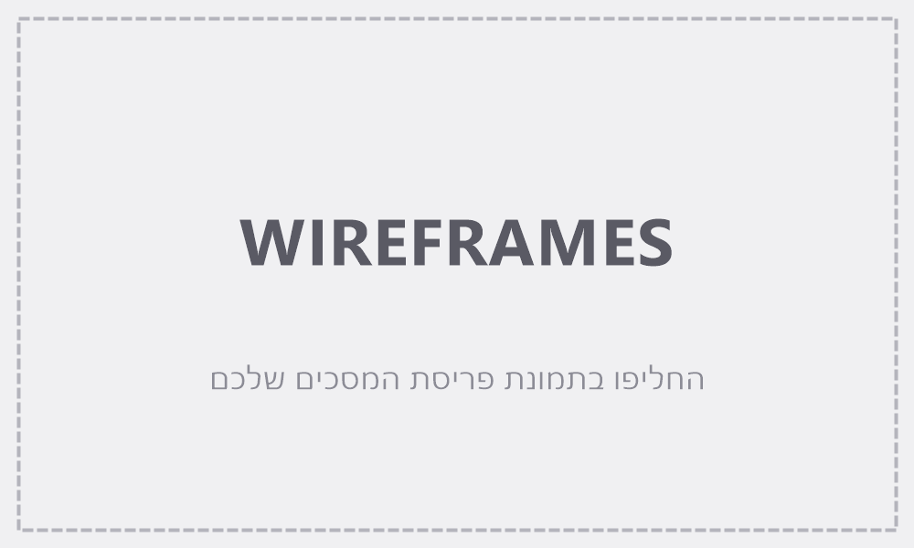
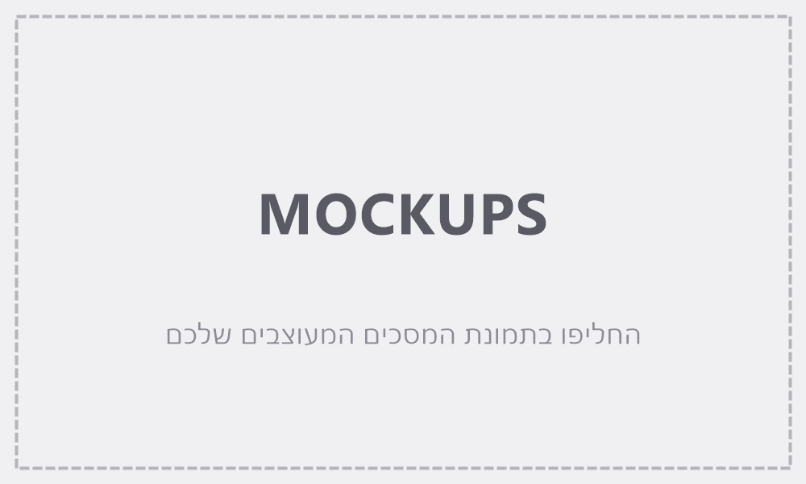
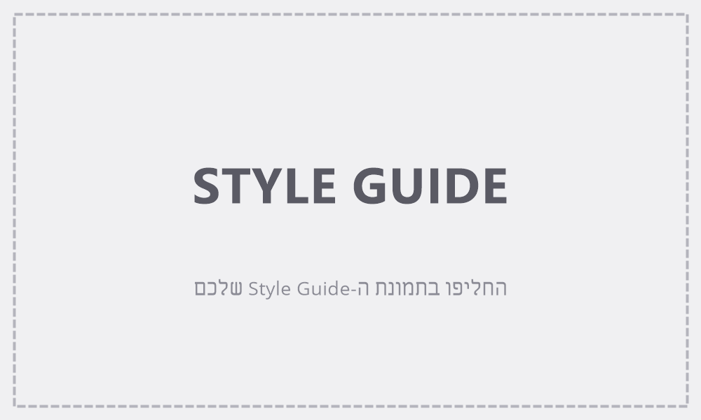

# Design (UI / UX)

> עיצוב האפליקציה, בשני חלקים: ה-**מסכים** (Screens) וה-**Style Guide**. המסמך מתבסס על ה-PRD ועל שלוש תמונות הייחוס, שנמצאות באותה תיקיית `spec/`. תאר את העיצוב בלבד — אל תחזור על דרישות מוצר או עקרונות UX שכבר תועדו ב-PRD, ואל תמציא פרטים שאינם מופיעים במקורות.

## 1. Screens – מסכי האפליקציה

### Wireframes (מבנה ופריסה)

### Mockups (המראה הסופי)

### רשימת המסכים
> רשומה אחת לכל מסך מרכזי.

#### <שם המסך>
- **מטרת המסך:** <מה המשתמש אמור לעשות או להשיג במסך>
- **מבנה ותוכן:** <רכיבי ה-UI המרכזיים — כפתורים, שדות, טפסים, רשימות, טקסטים, תפריטים, אזורי תוכן — והאופן שבו הם מסודרים>
- **פעולות וניווט:** <הפעולות שהמשתמש יכול לבצע והמעברים למסכים אחרים>

#### <מסך נוסף>
- **מטרת המסך:** <...>
- **מבנה ותוכן:** <...>
- **פעולות וניווט:** <...>

### מבנה הניווט
<תיאור קצר של מבנה הניווט הכללי בין המסכים.>

---

## 2. Style Guide – השפה העיצובית

### Color Palette
> הצבעים המרכזיים וקודי ה-HEX שלהם, ככל שהם מוגדרים במקורות.

| צבע / תפקיד | HEX |
|-------------|-----|
| <לדוגמה Primary> | `#______` |
| <...> | `#______` |

### Typography
<גופנים, היררכיית טקסט וגדלים מומלצים.>

### UI Style
<סגנון כפתורים, שדות, כרטיסים, תפריטים, אייקונים ורכיבי ממשק נוספים.>

### Visual Style
<צורות, פינות, קווי מתאר, צללים, מרווחים (Spacing), יישור, פריסה (Layout), סגנון תמונות או איורים והאווירה החזותית הכללית.>

### שפה וכיווניות
<שפת הממשק, כיווניות RTL / LTR ויישור הרכיבים, בהתאם ל-PRD.>
